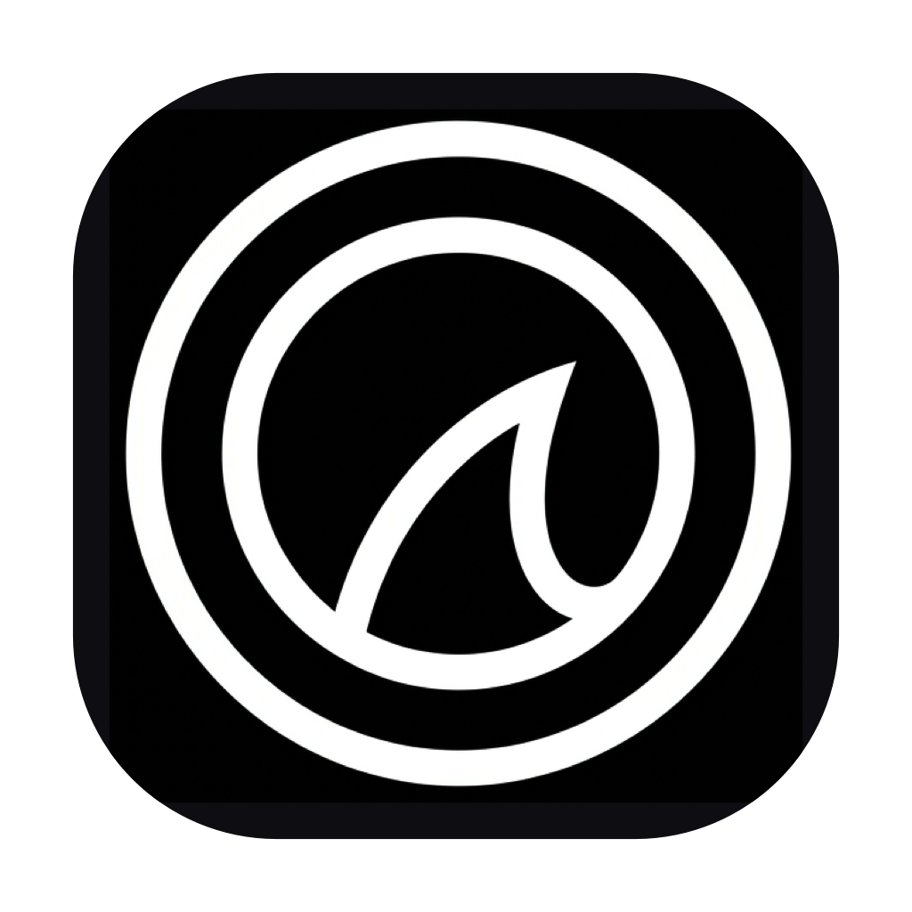

<p align="center">
  
</p>

<h1 align="center">OrcaCast</h1>

<p align="center">
  <strong>Ultra-low latency, high-fidelity iOS & Android display mirroring and casting utility for macOS.</strong>
</p>

<p align="center">
  <a href="LICENSE"></a>
  <a href="https://github.com/krish-dmg/OrcaCast/releases"></a>
  
  
</p>

---

## Overview

**OrcaCast** provides seamless, zero-latency screen mirroring and hardware control for mobile devices connected to macOS. Engineered for content creators, mobile game streamers, developers, and team demos, OrcaCast combines hardware-accelerated video decoding with direct peripheral input mappings.

Originally developed under private tooling, this release open-sources the client package, asset system, interface skins, and native macOS execution wrappers for the community under the MIT License.

---

## Features

- **Zero-Latency Display Mirroring**: High-framerate wired (USB) and wireless casting for both iOS and Android devices.
- **Hardware-Accelerated Decoding**: Leverages macOS native decoding for fluid 60 FPS playback with minimal CPU and thermal overhead.
- **Bi-Directional Peripheral Control**: Full HID keyboard, mouse, and custom gamepad touch mapping integration.
- **Custom Keymapping Profiles**: Ships with customizable keymaps for popular mobile touch interfaces and games.
- **Smart Launch & Auto-Centering**: Includes production shell automation (`run.sh`) to detect and center the viewport on primary displays automatically.
- **Extensible Skin & UI Engine**: Qt-based UI styling and vector icon set cleanly extracted in `extracted_source_assets/`.

---

## Repository Structure

```
OrcaCast/
├── OrcaCast.app/                # Complete macOS application bundle
│   └── Contents/
│       ├── MacOS/OrcaCast       # Core runtime engine and mirroring binary
│       ├── Resources/           # Application icons (OrcaCast.icns)
│       └── Frameworks/          # Embedded Qt5 and multimedia frameworks
├── run.sh                       # Launch script with automated window centering
├── branding/
│   ├── assets/
│   │   ├── OrcaCast_1024.png    # 1024x1024 high-resolution master icon
│   │   ├── OrcaCast.icns        # Multi-resolution macOS icon bundle
│   │   └── logo.svg             # Scalable vector branding asset
│   ├── iconset/                 # Full native Apple iconset (16x16 to 1024x1024)
│   └── concepts/                # Design exploration & monogram iterations
├── config/
│   └── userdefaults.conf        # Default application parameters and device profiles
└── extracted_source_assets/     # Qt stylesheets, SVG icons, and interface skins
```

---

## Getting Started

### Prerequisites

- macOS 10.15 (Catalina) or later (compatible with macOS Sonoma & Sequoia)
- Apple Silicon (M1/M2/M3/M4) or Intel Mac
- USB cable (for wired low-latency mode) or a local Wi-Fi network

### Installation & Launch

1. Clone or download the repository:
   ```bash
   git clone https://github.com/krish-dmg/OrcaCast.git
   cd OrcaCast
   ```

2. Make the launch script executable (if needed) and run:
   ```bash
   chmod +x run.sh
   ./run.sh
   ```

3. Connect your iOS device (via Lightning / USB-C) or Android device (with USB debugging enabled).

---

## Configuration

Default device configurations and audio/video pipeline settings are managed in [`config/userdefaults.conf`](config/userdefaults.conf):

```json
{
  "options": {
    "iosDevice": {
      "wiredFps": 60,
      "wiredResolution": 1,
      "wirelessFps": 30
    },
    "androidDevice": {
      "wiredBitrate": 9,
      "wiredFps": 4,
      "wiredHID": true
    }
  }
}
```

---

## Contributing

Contributions, bug reports, and pull requests are welcomed! Please read our [Contributing Guidelines](CONTRIBUTING.md) and [Security Policy](SECURITY.md) before submitting changes.

---

## License

OrcaCast is released under the [MIT License](LICENSE).
